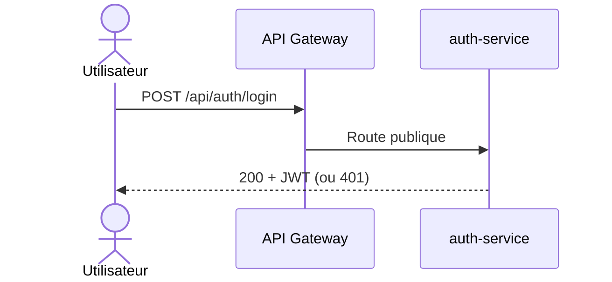

# Interactions entre services

## Candidature (synchrone + asynchrone)
```mermaid
sequenceDiagram
    actor Cand as Candidat
    participant GW as API Gateway
    participant APP as application-service
    participant OFF as offer-service
    participant MQ as RabbitMQ
    Cand->>GW: POST /api/applications (JWT)
    GW->>GW: Valider le JWT
    GW->>APP: Requête transmise
    APP->>OFF: GET /api/offers/{id} (synchrone)
    OFF-->>APP: 200 offre / 404
    APP->>APP: Enregistrer la candidature (PENDING)
    APP-)MQ: Publier application.submitted (asynchrone)
    APP-->>Cand: 201 Created
```

## Connexion

